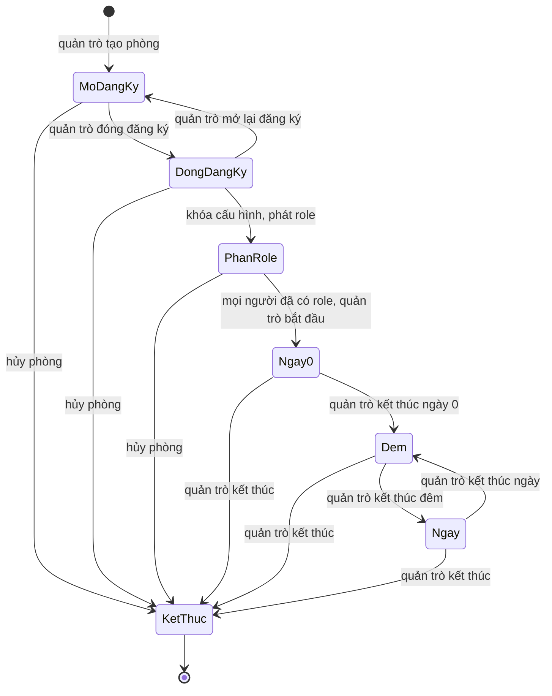

# Bước 1 — Đặc tả hành vi và giao diện

Trạng thái: **bản thiết kế để triển khai MVP**. Quyết định đã nhận từ chủ dự án: sau trận, người từng tham gia phòng xem toàn bộ chat đội và chat riêng với quản trò; người trong phòng xem đầy đủ danh mục role nhưng phân role cho từng người vẫn kín; chat chung được gửi ở sảnh chờ, ngày 0 và các ngày tiếp theo, chat đội chỉ gửi ban đêm, người chết chỉ đọc chat chung; người chết chỉ hiện công khai khi quản trò bấm công bố. Quản trò có thể tải icon role từ máy của mình trong giới hạn dung lượng. Hướng hình ảnh là Ma Sói huyền bí, tối màu và hai mẫu concept hiện tại được giữ làm tham chiếu. Chế độ chọn role theo lượt xáo ngẫu nhiên, giữ đúng số người từng phe, có tùy chọn cho phép role trùng và nút chọn ngẫu nhiên. Đây là bản mới cho web; mô tả role trong `archives/` chỉ dùng làm tư liệu.

## 1. Luồng ván

Các trạng thái `Dem`/`Ngay` là pha lặp; dữ liệu thực lưu `phase_type` và `round_number`. `PhanRole` là bước trước trận, gồm phát ngẫu nhiên hoặc người chơi chọn một trong ba lời mời role. Khi bắt đầu là **ngày 0**; sau đó **đêm 1, ngày 1, đêm 2, ngày 2…**. Không có đồng hồ tự chuyển pha, không tự xử lý kỹ năng hay điều kiện thắng. Quản trò nhập tên bên thắng và phần giải thích khi kết thúc.

**Tạm dừng** là cờ trên pha hiện tại, không tăng số ngày/đêm. Trong lúc tạm dừng, người chơi chỉ đọc dữ liệu đã có; không gửi chat hoặc yêu cầu role mới. Quản trò vẫn có thể gửi thông báo, ghi lý do, tiếp tục hoặc kết thúc. Nếu quản trò mất kết nối, pha giữ nguyên; không tự chuyển quyền hay tự kết thúc. Người chơi thấy trạng thái “Đang chờ quản trò”.

**Sửa sai:** trước khi kết thúc, quản trò dùng hành động đảo chiều hoặc đính chính có liên kết tới hành động gốc; cả hai vẫn nằm trong nhật ký. Ví dụ `giết → hồi sinh` tạo hai sự kiện và thông báo hồi sinh. Sau khi kết thúc, quản trò chỉ có thể thêm đính chính công khai cho bản tổng kết; không âm thầm đổi trạng thái hay xóa sự kiện. Việc kiểm duyệt nội dung vi phạm thuộc quyền quản trị nền tảng, được ghi bằng sự kiện có lý do.

### Ví dụ một ván

1. Quản trò tạo phòng 8 ghế, 7 người tham gia; chính sách công bố nhật ký hiện ở sảnh và từng người xác nhận. Họ đọc danh mục role và có thể chat chung ngay khi vào sảnh.
2. Quản trò đóng đăng ký, chọn cách phát role. Ở chế độ ngẫu nhiên, 7 slot role được xáo và phát kín. Ở chế độ chọn role, hệ thống xáo thứ tự 7 người; từng người lần lượt nhận riêng 3 role hợp lệ và chọn 1 hoặc bấm chọn ngẫu nhiên. Quản trò chỉ bắt đầu ngày 0 khi tất cả đã có role cuối.
3. Ngày 0, người sống tiếp tục chat chung. Quản trò kết thúc ngày 0, bắt đầu đêm 1.
4. Tiên Tri gửi yêu cầu soi một mục tiêu; Sói gửi đề nghị giết trong kênh/yêu cầu riêng. Hệ thống chỉ lưu đề nghị, không áp dụng kết quả.
5. Quản trò trả lời Tiên Tri, quyết định giết một người nhưng giữ kín trong đêm. Khi chuyển sang ngày 1, quản trò công bố cái chết; danh sách công khai và tab người chết cập nhật.
6. Nếu giết nhầm, quản trò hồi sinh và giải thích; cả hai quyết định xuất hiện theo thứ tự.
7. Quản trò kết thúc ván, nhập kết quả. Mọi người từng tham gia phòng có thể xem transcript gồm chat riêng, yêu cầu, câu trả lời, ghi chú quyết định và đính chính.

## 2. Mẫu role tùy chỉnh

Role là **dữ liệu của phòng**, không chứa mã chạy hay quy tắc tự áp dụng. Mẫu có các trường:

| Trường | Ý nghĩa / giới hạn MVP |
| --- | --- |
| `id`, `name`, `description` | ID nội bộ, tên duy nhất trong bộ role, mô tả văn bản đầy đủ do quản trò viết: điều kiện, số lượng/mục tiêu, ngoại lệ và cách dùng đều ghi ở đây |
| `faction_label` | Nhãn phe để phân loại và công bố sau trận; không tự tính thắng thua |
| `team_chat_id` | Đội chat được cấp quyền, có thể rỗng; độc lập với phe |
| `quantity` | Số bản role khi dùng chế độ phát ngẫu nhiên; tổng số lượng phải bằng số người. Ở chế độ chọn 1/3, số bản từng role linh hoạt theo lựa chọn của người chơi và tùy chọn role trùng |
| `icon_key` hoặc `uploaded_icon_id` | Chọn từ thư viện, dùng icon mặc định hoặc quản trò tải ảnh lên từ máy của mình |
| `request_phases` | Quyền gửi **yêu cầu tự do** của role chủ động: `day`, `night` hoặc cả hai; không mô hình hóa loại kỹ năng, số mục tiêu hay giới hạn người tác động |
| `request_when_dead` | Cho phép gửi yêu cầu sau khi chết nếu quản trò bật riêng cho role; mặc định tắt |
| `host_contact` | Quyền chủ động nhắn quản trò theo pha, quyền trả lời khi quản trò nhắn trước, và quyền khi đã chết |
| `role_kind` | Nhãn hiển thị `chủ động` hoặc `bị động`; role bị động không có `request_phases` và không được tự mở cuộc trò chuyện với quản trò |

Người chơi dùng một ô văn bản để trình bày yêu cầu theo `description`; có thể ghi tên người, con số, nhiều người hoặc không có mục tiêu. Máy chủ chỉ kiểm tra quyền gửi theo role, pha, trạng thái sống/chết và giới hạn độ dài/tần suất, **không kiểm tra luật bên trong mô tả**. Yêu cầu không giết, bảo vệ, tiết lộ thông tin hoặc trừ lượt dùng; quản trò tự quyết định và ghi kết quả. Một role có thể được gửi cả ngày lẫn đêm. Mẫu role được chụp thành snapshot lúc bắt đầu; sửa mẫu sau đó không đổi ván đang chạy. Đổi role/phe/đội chat trong ván là hành động quản trò được ghi log.

**Danh mục role công khai:** thành viên phòng xem được tất cả mẫu role đang dùng, gồm tên, mô tả đầy đủ, phe, đội chat, icon, loại chủ động/bị động, pha được gửi yêu cầu và quyền liên hệ quản trò. Ở chế độ phát ngẫu nhiên, hiện số bản đã cấu hình; ở chế độ 1/3, hiện các role ứng viên và số ghế từng phe. Danh mục có ở sảnh, lúc chờ chọn role và trong ván; sau khi khóa cấu hình, nó dùng snapshot của ván. Danh mục **không chứa tên người được gán role**, bộ ba riêng từng lượt, chat riêng hoặc hiệu ứng chưa công bố. Người ngoài phòng không xem được.

**Icon tải lên:** chỉ quản trò đang sửa bộ role được tải ảnh lên. MVP nhận PNG, WebP hoặc JPEG tĩnh, tối đa **1 MiB mỗi ảnh** và **512 × 512 px**; server kiểm tra nội dung thực, từ chối ảnh sai loại/quá giới hạn, chuẩn hóa thành icon vuông 128 × 128 px và bỏ metadata. Nếu không có ảnh hợp lệ, dùng icon mặc định. Icon trong danh mục là thông tin công khai, còn icon cạnh tên người chơi chỉ hiện khi role của người đó được phép công bố. Ảnh tải lên được lưu bền vững và tham chiếu trong snapshot ván, để tải lại/khởi động lại không mất icon.

Với role **bị động**, người chơi không thấy nút “Gửi yêu cầu dùng role” và không thể **chủ động** nhắn quản trò. Nếu `host_contact.reply_allowed=true`, quản trò có thể gửi tin trước và người chơi chỉ trả lời trong cuộc trò chuyện đó. Với role chủ động, quyền mở chat quản trò có thể giới hạn theo pha, độc lập với quyền gửi yêu cầu. Máy chủ kiểm tra các quyền này ở API và WebSocket; việc ẩn nút chỉ giúp UI rõ ràng.

| Role mẫu | Phe / đội chat | Kiểu | Mô tả và quyền liên hệ quản trò | Ý nghĩa |
| --- | --- | --- | --- | --- |
| Dân làng | Làng / không có | Bị động | Không có yêu cầu; chỉ trả lời nếu quản trò nhắn trước | Thảo luận ở chat chung |
| Người nổi tiếng | Làng / không có | Bị động | Không có yêu cầu; chỉ trả lời nếu quản trò nhắn trước | Quản trò tự quyết định khi nào công bố lúc người này chết |
| Xạ thủ | Làng / không có | Chủ động ngày | Mô tả cách đề nghị bắn; được gửi yêu cầu và mở chat quản trò ban ngày | Quản trò quyết định kết quả bắn |
| Tiên Tri | Làng / không có | Chủ động đêm | Mô tả cách soi; được gửi yêu cầu và mở chat quản trò ban đêm | Quản trò trả lời riêng; không tự tra role |
| Sói thường | Sói / Sói | Chủ động đêm | Mô tả cách đề nghị giết; được gửi yêu cầu và mở chat quản trò ban đêm | Quản trò chốt người chết và lý do |
| Sói cô độc | Trung lập / Sói, nếu quản trò muốn | Chủ động đêm | Mô tả cách hành động ban đêm; được gửi yêu cầu đêm | Minh họa phe thắng và đội chat là hai thuộc tính khác nhau |

Nội dung role mẫu chỉ là ví dụ cho sản phẩm. Khi nhập role từ `archives/roles.md`, quản trò có thể giữ luật chữ trong mô tả, còn app không tự thực thi luật đó.

### Chế độ phát role trước trận

| Chế độ | Cấu hình quản trò | Người chơi nhìn thấy | Điều kiện để bắt đầu |
| --- | --- | --- | --- |
| **Phát ngẫu nhiên** | Chọn số bản của từng role; tổng đúng bằng số ghế có người | Một role được phát riêng, không được tự đổi | Mọi người đã nhận role và quản trò xác nhận |
| **Chọn 1 trong 3** | Chọn số ghế của từng phe và danh mục role hợp lệ cho từng phe | Ba role được mời riêng; chọn và khóa một role | Mọi người đã chọn hoặc quản trò cho hệ thống chọn hộ từ ba lời mời còn chờ |

**Cấu hình chọn 1/3:** quản trò đặt số ghế từng phe, tổng đúng số người; chọn các role ứng viên của từng phe; bật/tắt `allow_duplicate_roles`. Mỗi role thuộc đúng một phe để đếm ghế. Phe và đội chat vẫn là hai thuộc tính độc lập. Chế độ phát ngẫu nhiên dùng số bản từng role và có thể phát nhiều bản như đã cấu hình; tùy chọn role trùng của chế độ 1/3 không làm đổi số bản đó.

**Trình tự chọn:** máy chủ xáo và lưu thứ tự người chơi trước lượt đầu. Chỉ người tới lượt nhận bộ ba và được chọn; người khác thấy trạng thái chờ, không thấy ba role này. Bộ ba gồm ba **tên role khác nhau**, có thể thuộc nhiều phe, và chỉ lấy từ phe còn ghế. Khi còn ghế và role hợp lệ, ưu tiên đưa ứng viên **Sói và Trung lập** vào bộ ba cho người chọn sớm; nếu cả hai phe còn ghế thì ưu tiên có cả hai. Đây là ưu tiên cơ hội chọn, không cam kết người đầu sẽ nhận phe hiếm. Mỗi lượt chọn được xử lý trong một giao dịch: xác thực người tới lượt, khóa ghế phe/role còn dùng được, chốt role, trừ một ghế của phe tương ứng, rồi mới mở lượt kế. Người chọn sau chỉ thấy các phe còn ghế. Không được tự đổi bộ ba hoặc đổi role đã chốt.

**Role trùng và kiểm tra trước khi phát:** khi bật, cùng tên role có thể được nhiều người chọn, nhưng một bộ ba không lặp tên; mỗi phe có ghế cần ít nhất ba role ứng viên khác nhau. Khi tắt, role đã chốt bị rút khỏi các lượt sau; role được mời nhưng không chọn quay lại danh mục. Để bảo đảm **cả người chọn cuối vẫn có đủ ba lựa chọn** trong mọi nhánh, MVP yêu cầu mỗi phe có `số ghế phe + 2` tên role ứng viên khác nhau khi tắt trùng. Đây là điều kiện đủ dễ kiểm tra, nên bộ role quá nhỏ sẽ phải bật role trùng, thêm role ứng viên hoặc dùng phát ngẫu nhiên. Máy chủ kiểm tra tổng ghế, số role ứng viên và khả năng tạo ba lựa chọn trước khi khóa cấu hình; không bắt đầu phát nếu không hợp lệ.

**Chọn ngẫu nhiên và người vắng mặt:** nút “Chọn ngẫu nhiên trong 3” để máy chủ chọn đều một trong ba role đang mời, không rút lại bộ ba. Nếu người tới lượt không thể chọn, quản trò có thể bấm “Chọn ngẫu nhiên hộ” sau khi ghi lý do; hệ thống không tự chọn khi hết giờ ở MVP. Người chơi chỉ thấy bộ ba của mình, số thứ tự lượt và tiến độ đã chọn/chưa chọn; quản trò thấy toàn bộ tiến độ và bộ ba đang chờ. Thứ tự xáo, ba lời mời, lựa chọn, người thực hiện và lý do chọn hộ được lưu để công bố sau trận. Không tự bắt đầu ngày 0 khi còn người chưa có role. Nếu cần giữ **chính xác số bản từng role**, dùng chế độ phát ngẫu nhiên.

## 3. Ma trận quyền mặc định

Ký hiệu: `R` đọc, `W` gửi/tạo, `—` không truy cập. “Người chơi” dưới đây là thành viên phòng đã xác thực. Quản trò không chiếm một ghế người chơi. Các thay đổi chính sách của quản trò được ghi sự kiện và chỉ có hiệu lực từ thời điểm đổi.

| Tài nguyên / thời điểm | Quản trò | Người sống đúng quyền | Người sống khác quyền | Người chết | Người ngoài phòng |
| --- | --- | --- | --- | --- | --- |
| Sảnh, danh sách thành viên | R/W thiết lập | R; vào/rời khi mở | R; vào/rời khi mở | R | — |
| Danh mục mẫu role và icon công khai | R/W trước khi khóa cấu hình | R toàn bộ | R toàn bộ | R toàn bộ | — |
| Role được gán cho từng người, hiệu ứng chưa công bố | R/W | R của bản thân | — | R của bản thân | — |
| Chat chung ở sảnh chờ, khi phát/chọn role và các pha ngày kể từ ngày 0 | R và thông báo | R/W | R/W | R | — |
| Chat chung ban đêm hoặc tạm dừng | R và thông báo | R | R | R | — |
| Chat đội ban đêm | R và tin quản trò | R/W nếu là thành viên đội hiện tại | — | Chỉ R tin từng được phép xem trước khi chết | — |
| Chat đội ban ngày hoặc tạm dừng | R và tin quản trò | R lịch sử đã được phép xem | — | R lịch sử đã được phép xem | — |
| Chat riêng với quản trò | R/W | R cuộc trò chuyện của mình; W chỉ khi role cho mở chat ở pha hiện tại hoặc trả lời tin quản trò đã mở | — | R của mình; W chỉ nếu role cho phép khi chết hoặc trả lời tin quản trò đã mở | — |
| Yêu cầu role dạng văn bản | R/W trả lời | R/W của mình nếu role chủ động và pha hiện tại được phép | — | Chỉ khi role chủ động và cấu hình cho phép gửi khi chết | — |
| Hành động/ghi chú quản trò chưa công bố | R/W | — | — | — | — |
| Thông báo người chết | R/W | R phần được công bố | R phần được công bố | R phần được công bố | — |
| Transcript sau khi kết thúc | R | R toàn bộ | R toàn bộ | R toàn bộ | — |

**Đổi phe/đội:** quyền nhận **tin đội mới** được tính lại ngay. Người rời đội không nhận tin mới; tin cũ mà họ đã có quyền xem vẫn đọc được. Người gia nhập đội không đọc lịch sử trước khi gia nhập, trừ khi quản trò có một hành động công bố riêng. Khi chết, thành viên ngừng nhận tin đội mới. Hệ thống kiểm tra quyền cho từng lần đọc/gửi và từng sự kiện WebSocket; UI ẩn tab không thay thế kiểm tra server. Quản trò xem mọi kênh để điều hành.

**Quyền nhắn quản trò theo role:** role bị động không được mở chat hoặc yêu cầu dùng role. Quản trò có thể gửi tin trước để họ trả lời nếu mẫu role cho phép; mọi trao đổi này vẫn được công bố sau trận. Yêu cầu tự do chỉ gửi ở pha thuộc `request_phases`; quyền chủ động mở chat quản trò được kiểm tra riêng theo `host_contact.initiate_phases`. Khi phòng tạm dừng, không ai gửi chat hoặc yêu cầu role mới. Quyền chat đội phụ thuộc `team_chat_id` và chính sách pha, không phụ thuộc `role_kind`.

**Chat sảnh:** ở các trạng thái trước ngày 0, cột “người sống” trong bảng nghĩa là thành viên đã vào phòng. Chỉ thành viên đã xác nhận chính sách và vào phòng được đọc/gửi chat chung. Chat hoạt động từ khi phòng ở sảnh chờ, kể cả lúc đóng đăng ký hoặc chờ chọn role, và tiếp tục trong ngày 0. Người ngoài phòng hoặc người chưa xác nhận không được đọc/gửi; quyền chat đêm, lúc tạm dừng và của người chết theo bảng trên. Tin ở sảnh thuộc transcript sau trận và chịu cùng giới hạn độ dài/tần suất như chat trong ván.

**Thông tin chết:** thao tác `giết` đổi trạng thái thật ngay cho quản trò và người bị giết, đồng thời ngừng quyền gửi của người chết. Danh sách công khai và tab người chết **chưa đổi** cho tới khi quản trò bấm `công bố`; số người sống hiển thị công khai cũng dựa trên thông tin đã công bố. Khi công bố, quản trò chọn có tiết lộ nguyên nhân và role hay không. Tab có dòng “Người chơi X đã chết” nếu không công bố chi tiết. Hồi sinh cũng có thể giữ kín tới lúc công bố và luôn thêm dòng mới, không xóa dòng cũ. Chủ dự án đã chọn cơ chế công bố riêng này.

## 4. Công bố nhật ký sau trận

Đây là chính sách cố định cho MVP, được chủ dự án chọn: **người từng tham gia phòng** (kể cả người đã chết/rời trong trận) xem được toàn bộ chat chung, chat đội, chat riêng với quản trò, yêu cầu role, phản hồi, role, ghi chú và quyết định sau khi trận kết thúc. Người ngoài phòng không được xem. Quản trò không được tắt riêng phần chat sau khi đã có người tham gia. Bản xuất dùng cùng phạm vi quyền.

Văn bản ở sảnh, ngay trước nút tham gia:

> Sau khi trận kết thúc, tất cả người đã tham gia phòng có thể xem toàn bộ chat trong trò chơi, gồm chat đội và chat riêng với quản trò, cùng yêu cầu role và quyết định của quản trò. Hãy chỉ gửi nội dung bạn chấp nhận công bố sau trận.

Nút xác nhận: **“Tôi đã hiểu và tham gia phòng”**. Ghi lại phiên bản chính sách và thời điểm xác nhận. Nếu người chơi chưa xác nhận, không cấp ghế. Trước khi kết thúc, mỗi người chỉ thấy nội dung theo ma trận quyền. Trang tổng kết giải thích rằng log ghi nhận hành động trong hệ thống, không tự chứng minh quyết định đúng luật hoặc những việc diễn ra ngoài web.

## 5. Wireframe

Mở [`wireframes.html`](wireframes.html) trong trình duyệt. Đây là wireframe có thể chuyển giữa **sảnh, danh mục role, thiết lập role, chọn role trước trận, người chơi, quản trò, thông báo người chết, tổng kết**; nội dung là dữ liệu mẫu. Mẫu sảnh và thẻ role dùng hai hình concept trong `assets/`. Giao diện này không nối backend và không thực thi quyền; các nhãn “chỉ mình bạn”, “công bố sau trận” chỉ để kiểm tra cách trình bày.

Trên màn hình nhỏ, các cột ghép thành một cột và nút chính giữ ở phần đầu. Nội dung chat, yêu cầu và người chết có nhãn văn bản; icon không là tín hiệu duy nhất. Người dùng có thể chuyển tab bằng phím, nhìn thấy focus, và đọc nội dung khi ảnh không tải.

## 6. Tình huống nghiệm thu MVP

| Mã | Hành vi cần chứng minh | Kết quả mong đợi |
| --- | --- | --- |
| AC-01 | Quản trò tạo phòng 8 ghế, 7 người đồng ý chính sách và tham gia | Sảnh hiện đúng 7 người, không ai vào hai ghế |
| AC-02 | Đóng đăng ký, phát ngẫu nhiên 7 role và bắt đầu | Số lượng từng role khớp; mỗi người chỉ thấy role **được gán** của mình, vẫn xem được danh mục mẫu role |
| AC-03 | Sửa mẫu role sau khi bắt đầu | Snapshot trong ván không đổi |
| AC-04 | Ngày 0 chuyển đêm 1, ngày 1; thử tạm dừng | Thứ tự đúng; khi tạm dừng không nhận chat/yêu cầu mới |
| AC-05 | Sói gửi chat đội; Dân làng và người ngoài thử đọc qua UI/API | Chỉ thành viên được phép và quản trò xem được |
| AC-06 | Đổi một người từ Sói sang Làng rồi gửi tin đội | Người đó không nhận tin Sói mới, vẫn xem tin cũ từng có quyền |
| AC-07 | Tiên Tri gửi yêu cầu soi bằng văn bản tự do, quản trò trả lời và liên kết quyết định | Yêu cầu không tự đổi trạng thái; chỉ hai bên thấy nội dung yêu cầu trong trận |
| AC-08 | Quản trò giết kín trong đêm, công bố ở ngày sau, rồi hồi sinh và công bố | Trước công bố người khác không thấy; sau công bố danh sách và tab cùng đúng; đủ sự kiện |
| AC-09 | Quản trò đính chính một lý do sai | Sự kiện gốc còn nguyên và có liên kết tới đính chính |
| AC-10 | Người chơi mất kết nối lúc có chat và hành động | Nối lại lấy đủ sự kiện, không trùng |
| AC-11 | Quản trò kết thúc và nhập kết quả | Người tham gia xem đủ transcript; người ngoài bị từ chối |
| AC-12 | Hai trình duyệt gửi cùng một thao tác hoặc thao tác đồng thời | Không nhân đôi, sự kiện có thứ tự nhất quán |
| AC-13 | Tắt/mở lại API và Redis trong ván | Trạng thái đã lưu còn đủ, client bắt kịp từ DB |
| AC-14 | Mở các màn trên điện thoại; tắt ảnh hoặc dùng mạng chậm | Chức năng và nhãn vẫn đọc được; icon mẫu công khai không làm lộ người giữ role |
| AC-15 | Thử tải 500 người trên 20 phòng theo mục tiêu trong `CHECKLIST.md` | Đạt ngưỡng đã đặt, không mất sự kiện đã commit |
| AC-16 | Tạo role Xạ thủ dùng ban ngày và Tiên Tri dùng ban đêm; thử gửi yêu cầu sai pha qua UI/API | Chỉ đúng pha mới gửi được; không áp dụng hiệu ứng tự động |
| AC-17 | Tạo Người nổi tiếng bị động; thử mở chat quản trò và gửi yêu cầu | Cả hai bị chặn; khi quản trò nhắn trước, người chơi được trả lời nếu đã bật quyền này |
| AC-18 | Chọn chế độ 1/3 cho 7 người, đặt số ghế Làng/Sói/Trung lập và cho mọi người chọn theo lượt xáo | Chỉ người tới lượt thấy 3 role riêng có thể khác phe; sau mỗi lựa chọn số ghế cập nhật; kết quả cuối đúng từng phe, role được khóa và chụp snapshot |
| AC-19 | Người tới lượt bấm chọn ngẫu nhiên; một người khác vắng mặt để quản trò chọn ngẫu nhiên hộ, có lý do | Mỗi lần hệ thống chọn trong đúng 3 lời mời hiện tại; không tự bắt đầu trước khi đủ role; thứ tự, lời mời, người chọn hộ và lý do có trong nhật ký sau trận |
| AC-20 | Bật rồi tắt tùy chọn role trùng trong chế độ 1/3; thử cấu hình thiếu role và hai lệnh chọn cùng lượt | Khi bật, hai người có thể cùng role; khi tắt, role đã chốt không xuất hiện lại; cấu hình không bảo đảm 3 lựa chọn bị chặn; lệnh đồng thời không vượt ghế phe hoặc chọn hai lần |
| AC-21 | Từ sảnh, lúc chờ chọn role và trong ván, hai thành viên xem toàn bộ danh mục role; người ngoài thử mở API danh mục | Thành viên thấy mô tả/điều kiện, phe, đội, icon, quyền và số bản/ghế phe; không thấy ai được gán role hoặc bộ ba riêng; người ngoài bị từ chối |
| AC-22 | Gửi yêu cầu bằng con số, nhiều người hoặc không có mục tiêu; thử sai pha và role bị động | Ô văn bản giữ nguyên nội dung; máy chủ kiểm tra quyền/pha và giới hạn văn bản, không tự diễn giải luật hoặc bắt nhập mục tiêu |
| AC-23 | Quản trò tải PNG/WebP/JPEG hợp lệ rồi thử ảnh quá 1 MiB, quá 512 × 512 px hoặc sai loại | Icon hợp lệ hiện trong danh mục và còn sau tải lại; ảnh không hợp lệ bị từ chối ở server, icon mặc định vẫn dùng được |
| AC-24 | Hai thành viên chat chung ở sảnh chờ, khi đang chờ chọn role và ngày 0; người ngoài/chưa xác nhận thử gửi; chuyển sang đêm 1 | Tin hợp lệ hiển thị và vào log sau trận; người ngoài/chưa xác nhận bị từ chối; ban đêm chat chung chỉ đọc theo mặc định |

## 7. Pixel art: style guide và danh mục MVP

**Hướng đã chọn:** Ma Sói huyền bí, tối màu. Chủ dự án đã chọn giữ hai mẫu concept hiện tại làm tham chiếu. Bảng màu đề xuất cho UI: nền `#101626`, mặt panel `#1C2636`, viền `#59637A`, chữ chính `#F4E8D0`, chữ phụ `#B6C2CE`, điểm nhấn trăng `#E9B66F`, thông tin đêm `#74B7C9`, cảnh báo `#D6756E`. Đây là mã màu khởi đầu; cần kiểm tra tương phản thực trên UI.

Quy ước dự kiến: icon cơ sở 24×24 hoặc 32×32 pixel, xuất PNG/WebP có alpha, nhân ở tỉ lệ nguyên với `image-rendering: pixelated`; avatar/portrait lớn hơn nhưng cùng bảng màu. Nền rộng có vùng tương đối yên để đặt panel. Tránh hoạt ảnh chuyển động liên tục; nếu có hiệu ứng ngắn, hỗ trợ giảm chuyển động. Hai ảnh concept hiện tại dùng để chốt **bầu không khí**; cần vẽ/điều chỉnh lại cho lưới pixel thật và thống nhất kích thước trước khi dùng như asset production. Icon quản trò tải lên có thể không cùng phong cách pixel art; vẫn hiển thị trong khung icon chuẩn và giữ tên role bằng chữ. Ảnh tải lên lưu ở kho bền vững của ứng dụng, không nằm trong bộ asset nguồn của repo.

| Màn / trạng thái | Asset MVP dự kiến | Tên file dự kiến | Nguồn |
| --- | --- | --- | --- |
| Sảnh | Nền làng đêm, khung phòng, avatar mặc định | `lobby-night.webp`, `frame-room.png`, `avatar-default.png` | Concept tạo bằng imagegen; bản cuối tinh chỉnh |
| Thẻ role | Chân dung Tiên Tri mẫu, icon role mặc định, icon phe | `role-seer.png`, `role-default.png`, `faction-*.png` | Concept tạo bằng imagegen; thư viện icon tự tạo |
| Pha | Nền ngày/đêm, icon mặt trời/trăng | `phase-day.webp`, `phase-night.webp`, `phase-*.png` | Tạo mới theo style guide |
| Trạng thái | Sống, chết, hồi sinh, hiệu ứng chung | `state-*.png`, `effect-default.png` | Tạo mới theo style guide |
| Chat/yêu cầu | Chat chung, đội, quản trò, tin mới, chờ/chấp nhận/từ chối | `chat-*.png`, `request-*.png` | Tạo mới theo style guide |
| Thông báo/tổng kết | Mốc chết/hồi sinh, ngày/đêm, đính chính | `notice-*.png`, `timeline-*.png` | Tạo mới theo style guide |

Hai hình **concept**, chưa là asset cuối: [`assets/lobby-concept.png`](assets/lobby-concept.png) và [`assets/seer-concept.png`](assets/seer-concept.png). Ghi nhận nguồn ngay trong repo; với ảnh từ nguồn ngoài trong tương lai, kiểm tra quyền sử dụng trước khi nhập. Icon của **mẫu role** được phép công khai trong danh mục; không đặt mối liên kết giữa icon/role và **tên người đang giữ role** trong HTML hay payload gửi cho người không có quyền xem, kể cả khi CSS đang ẩn chúng.
